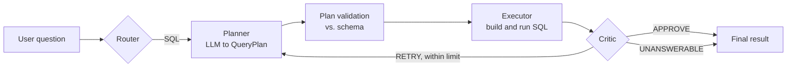
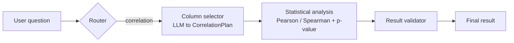

# QueryCraft

**Ask questions about your data in plain English, without letting an LLM write raw SQL.**

QueryCraft is a multi-agent analytics app. An LLM turns your question into a *structured query plan*, a deterministic engine compiles that plan into parameterized SQL, a read-only executor runs it, and a Critic decides whether the answer is good enough or should be retried. It also routes correlation questions to a separate statistical workflow (Pearson / Spearman, p-values, observation counts).


---

## Why this design?

Most text-to-SQL demos execute whatever string the model returns. That is fragile and unsafe. QueryCraft makes a different trade-off:

> **The LLM never writes SQL.** It fills in a typed `QueryPlan` (tables, joins, filters, aggregations, grouping, ordering, limit). Code, not the model, builds the SQL.

This gives up some expressiveness in exchange for safety and predictability: every table, column, join and operator is checked against the real database schema before anything runs.

---

## Architecture

LangGraph orchestrates two analysis paths, chosen by a router.

**SQL path** (default)



**Correlation path**



| Component | Responsibility |
|---|---|
| **Router** | Detects correlation-style questions and picks the path. |
| **Planner** | Converts the question and schema into a Pydantic `QueryPlan`. Never emits SQL. Accepts feedback from the Critic on retries. |
| **Plan validation** | Deterministic checks of tables, columns, joins (must match known relationships), operators, aggregations, ordering and limits. |
| **Executor** | Compiles the plan into parameterized SQL and runs it in a locked-down, read-only connection. |
| **Critic** | Rule-based checks for errors, plus an LLM judge that asks whether a successful query actually answers the user's question. Returns `APPROVE`, `RETRY` or `UNANSWERABLE` with a failure origin. |
| **Retry loop** | Sends retryable failures back to the Planner with specific feedback, capped by `max_retries` (default 2). |
| **Statistical analysis** | Selects two numeric columns, then computes the coefficient, p-value, direction, strength label and valid/excluded observation counts. |

---

## Safety model

Defense in depth: no single layer is trusted on its own.

| Layer | What it does |
|---|---|
| Structured output | The model can only return a typed `QueryPlan`, not free-form SQL. |
| Schema validation | Unknown tables, columns and joins are rejected. Joins must match declared or data-validated inferred relationships. |
| Identifier whitelisting | Identifiers must match a strict pattern and are quoted. Aggregations and `ORDER BY` accept only recognized forms. |
| Parameterized values | Filter values are bound parameters and never concatenated into SQL. |
| Operator allowlist | Only `= != > >= < <= LIKE IN IS NULL IS NOT NULL`. |
| Read-only connection | SQLite is opened with `mode=ro`. |
| SQLite authorizer | Only `SELECT` / `READ` / `FUNCTION` actions are permitted. Everything else is denied. |
| Resource limits | A progress handler aborts runaway queries. `LIMIT` is capped at 1,000 rows. |

These are covered by tests (see [Testing](#testing)).

---

## Features

- **Natural language to SQL** through structured plans, with the generated SQL, plan and Critic verdict shown in the UI.
- **Self-correcting workflow:** the Critic can send failed or off-target attempts back to the Planner with targeted feedback, up to a retry limit.
- **Statistical correlation analysis** for numeric columns: Pearson or Spearman, p-value, direction and strength, rows used and excluded, with an explicit "association is not causation" note.
- **Bring your own data:** upload a CSV or Excel file, preview types and missing values, and query it as its own SQLite database.
- **Automatic schema discovery:** reads tables, columns and primary keys, uses declared foreign keys, and infers `*_id` relationships that are then verified against the data.

---

## Example

**Question** (wine-quality dataset): *"What is the relationship between fixed acidity and alcohol?"*

```json
{
  "analysis": "correlation",
  "table": "wineqt",
  "column_x": "fixed acidity",
  "column_y": "alcohol",
  "method": "pearson",
  "correlation_coefficient": -0.0751,
  "p_value": 0.0111,
  "strength": "very weak",
  "direction": "negative",
  "observations_used": 1143,
  "observations_excluded": 0
}
```

The result shows that the relationship is statistically detectable at n = 1,143 but practically very weak, which is the distinction the output is designed to make visible.

Sample SQL-path questions on the bundled e-commerce database:

- *How many customers are in the database?*
- *What are the top five products by price?*
- *Which 5 customers placed the most orders?*

---

## Tech stack

| Layer | Tools |
|---|---|
| Orchestration | LangGraph |
| LLM | Groq via `langchain-groq` (default `openai/gpt-oss-120b`, configurable) |
| Validation | Pydantic |
| Database | SQLite |
| Data / stats | pandas, SciPy |
| UI | Streamlit |

---

## Getting started

**Requirements:** Python 3.10+ and a [Groq API key](https://console.groq.com/).

```bash
git clone https://github.com/shravanid307/QueryCraft.git
cd QueryCraft

python -m venv .venv
# macOS / Linux
source .venv/bin/activate
# Windows (PowerShell)
.\.venv\Scripts\Activate.ps1

pip install -r requirements.txt
```

Create a `.env` file in the project root:

```env
GROQ_API_KEY=your_groq_api_key
GROQ_MODEL=openai/gpt-oss-120b
```

Run the app:

```bash
python -m streamlit run app.py
```

> Never commit `.env`. It is already listed in `.gitignore`.

---

## Usage

1. **Ask Questions:** pick a database, type a question, and click **Run Query**. Inspect the result table, the plan, the generated SQL and the Critic's decision.
2. **Add Data:** upload a CSV or `.xlsx`, review the preview and column info, then add it. It becomes a separate selectable database.
3. For correlation, ask about the relationship between two numeric columns, e.g. *"What is the correlation between alcohol and quality?"*

---

## Project structure

```
QueryCraft/
├── agents/
│   ├── schema_extractor.py     # tables, columns, keys, relationship inference
│   ├── planner.py              # QueryPlan / CorrelationPlan models, LLM planning, plan validation
│   ├── executor.py             # plan -> parameterized SQL, read-only execution
│   ├── critic.py               # LLM + rule-based evaluation of attempts
│   ├── statistical_analysis.py # Pearson / Spearman, p-values, observation counts
│   └── graph.py                # LangGraph workflow, routing and retry logic
├── data/
│   ├── generate_db.py          # builds the sample e-commerce database
│   ├── ecommerce.db
│   └── uploaded_databases/     # user-uploaded datasets
├── app.py                      # Streamlit interface
├── test_*.py                   # tests
├── requirements.txt
└── README.md
```

---

## Testing

Safety and executor tests run fully offline:

```bash
python -m pytest test_sql_safety.py test_executor_edge_cases.py
```

They cover read-only enforcement, parameterized filter values, rejection of malicious identifiers and rejection of unknown tables.

Other tests (planner, Critic, retry limits, full graph) exercise the live LLM workflow and require `GROQ_API_KEY`.


---

## Design decisions and trade-offs

- **Plans instead of raw SQL.** Safer and easier to validate, at the cost of expressiveness.
- **Two layers of validation.** The Planner validates plans, and the Executor re-validates before building SQL, so a bad plan can't slip through a mocked or modified Planner.
- **Failure-origin routing.** The Critic labels where a failure came from (Planner, Executor, Database), so retries target the right stage.
- **Retry cap.** Prevents infinite loops and bounds LLM cost.
- **Separate statistical path.** A correlation question needs a coefficient and p-value, not a grouped average, so it gets its own workflow instead of being forced through SQL.

---

## Limitations

- Supports a deliberate SQL subset: inner joins, filters, `COUNT/SUM/AVG/MIN/MAX`, grouping, ordering and limits. No `HAVING`, `DISTINCT`, subqueries or date functions yet.
- Results are capped at 1,000 rows, and long-running queries are aborted.
- Correlation questions are detected by keywords, so unusual phrasing may route to the SQL path.
- The statistical result check is a deterministic sanity check (valid coefficient, enough observations), not an independent statistical review.
- SQLite only.
- Answer quality depends on the LLM, the schema and the wording of the question. A formal accuracy benchmark is not published yet.

---

## Roadmap

- [ ] Evaluation harness with a fixed question set and accuracy / retry metrics
- [ ] `HAVING`, `DISTINCT`, date handling and left joins
- [ ] Richer statistical checks (small-sample and effect-size warnings, categorical-column detection)
- [ ] Charts for query and correlation results
- [ ] Mocked-LLM unit tests and CI
- [ ] Support for additional databases

---

## Author

**Shravani Dixit** · [GitHub @shravanid307](https://github.com/shravanid307)

## License

No license has been selected yet. Add a `LICENSE` file before reuse or redistribution.
